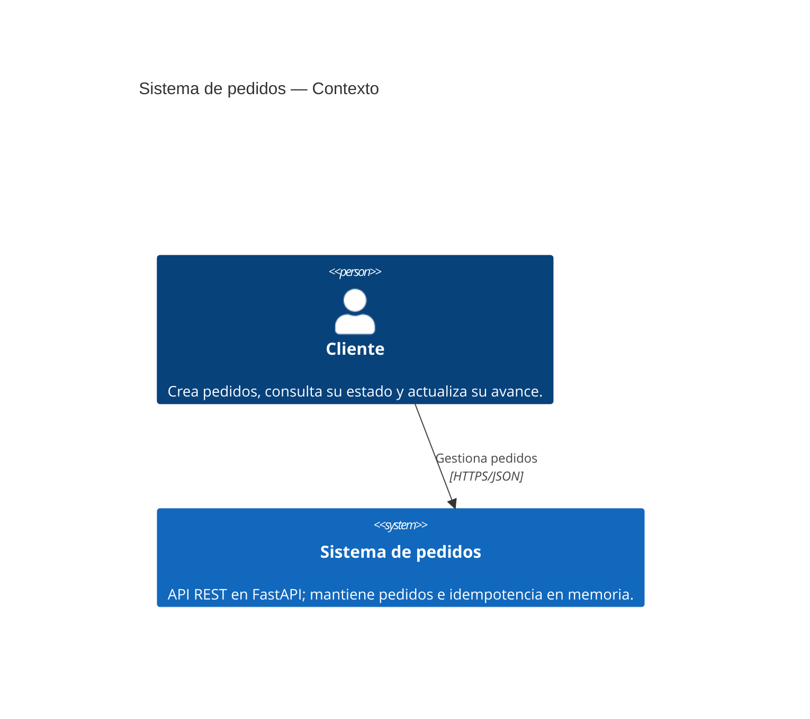

# Sistema de pedidos

API REST de pedidos construida con FastAPI y conectada a un servicio de caja
mediante gRPC. Los pedidos y las ventas se almacenan en memoria. La API evita
pedidos duplicados mediante `X-Idempotency-Key` y caja evita cobros repetidos
mediante el ID del pedido. Los pagos son simulados y los comprobantes son internos
a la práctica.

## Requisitos

- Python 3.10 o superior
- pip

## Instalación

Desde la carpeta raíz del proyecto, crea y activa un entorno virtual:

```powershell
py -m venv .venv
.\.venv\Scripts\Activate.ps1
```

Instala las dependencias fijadas:

```powershell
python -m pip install -r requirements.txt
```

## Generar el código gRPC

Desde la raíz del proyecto, después de instalar las dependencias:

```powershell
python -m grpc_tools.protoc -I . --python_out=. --grpc_python_out=. src/proto/billing.proto
```

Los archivos generados no se incluyen en Git. Repite este comando si cambia el
contrato `.proto`.

## Ejecutar los servicios

En una terminal con el entorno virtual activado, inicia caja:

```powershell
python -m src.billing_server
```

Caja escucha en `127.0.0.1:50051`. En otra terminal, también desde la raíz y con
el entorno activado, inicia REST:

```powershell
python -m uvicorn src.main:app --reload
```

La API queda disponible en <http://127.0.0.1:8000>. FastAPI publica la
documentación interactiva en <http://127.0.0.1:8000/docs> y el esquema OpenAPI
en <http://127.0.0.1:8000/openapi.json>.

## Endpoints

| Método | Ruta | Descripción |
|---|---|---|
| `POST` | `/orders/` | Crea un pedido y calcula `total` como `quantity * unit_price`. Requiere `X-Idempotency-Key`. |
| `GET` | `/orders/` | Lista todos los pedidos. |
| `GET` | `/orders/{order_id}` | Consulta un pedido por su ID de 8 caracteres. |
| `POST` | `/orders/{order_id}/pay` | Reintenta el pago de un pedido pendiente. No requiere cuerpo. |
| `PATCH` | `/orders/{order_id}/status` | Actualiza el estado a `PENDING`, `PREPARING`, `READY` o `PAID`. |

Ejemplo de cuerpo para crear un pedido:

```json
{
  "product": "Café",
  "quantity": 2,
  "unit_price": 3.50
}
```

El pedido se registra inicialmente con estado `PENDING`. REST llama a caja por
gRPC y, si el pago se aprueba, devuelve el pedido en `PAID`. La llamada tiene un
límite de espera de dos segundos. Si falla, REST responde `503` con el ID del
pedido y lo conserva en `PENDING`. El precio unitario debe
ser mayor que cero y tener hasta dos posiciones decimales. Los estados
aceptados están restringidos por el modelo; se permite seleccionar cualquiera
de ellos en una actualización.

## Prueba de idempotencia

Envía el mismo `POST` más de una vez con la misma clave y el mismo cuerpo. La
API devolverá el mismo pedido y no creará un duplicado:

```powershell
curl.exe -i -X POST "http://127.0.0.1:8000/orders/" `
  -H "Content-Type: application/json" `
  -H "X-Idempotency-Key: pedido-cliente-123" `
  -d '{"product":"Cafe","quantity":2,"unit_price":"3.50"}'
```

Repite el comando exactamente para comprobar que la respuesta conserva el
mismo `id`. Si se reutiliza una clave con un cuerpo diferente, la API responde
`409 Conflict`. Si falta la clave, FastAPI rechaza la petición. Las claves y los
pedidos viven en memoria, por lo que se reinician al detener REST. Las ventas y
los comprobantes también se pierden al detener caja.

## Pruebas de caja y gRPC

Con el código gRPC generado:

```powershell
python -m unittest discover -s tests -v
```

Las seis pruebas levantan servidores gRPC locales temporales; no requieren
iniciar caja ni REST manualmente. Comprueban pagos, resumen de ventas,
reintentos, validaciones y desconexión de caja con recuperación del pago.

Para demostrar manualmente el fallo de caja:

1. Mantén REST ejecutándose y detén caja con `Ctrl+C` en su terminal.
2. Crea un pedido en `http://127.0.0.1:8000/docs` usando una nueva clave
   `X-Idempotency-Key`. Obtendrás `503` y el `order_id` en el detalle del error.
3. Consulta ese ID con `GET /orders/{order_id}`: estará en `PENDING`.
4. Inicia caja otra vez y ejecuta `POST /orders/{order_id}/pay` sin cuerpo.
   El pedido pasará a `PAID`.
5. Repite el pago: el pedido seguirá en `PAID` y no se registrará otra venta.

## Consultar ventas por gRPC

Con caja ejecutándose, desde PowerShell:

```powershell
@'
import grpc
from src.proto import billing_pb2, billing_pb2_grpc

with grpc.insecure_channel("127.0.0.1:50051") as channel:
    client = billing_pb2_grpc.BillingServiceStub(channel)
    summary = client.GetSalesSummary(billing_pb2.SalesSummaryRequest(), timeout=2)
    print("Ventas:", summary.sales_count)
    print("Total recaudado:", summary.total_revenue)
'@ | python -
```

## Documentación

- [ADR de REST](docs/adr-001-rest.md)
- [ADR de gRPC](docs/adr-002-grpc.md)
- [Mapa de microservicios](docs/mapa-microservicios.md)
- [Prueba de caja no disponible](docs/prueba-grpc.md)

## Diagrama de Contexto C4 — Nivel 1




## Cocina con Sockets TCP (Integrante 3; implementación asistida por IA)

En una tercera terminal con el entorno virtual activado, inicia cocina:

```powershell
python -m src.kitchen_server
```

Cocina escucha en `127.0.0.1:50052`. Inicia los tres procesos por separado:
**caja**, **cocina** y **REST**. Luego crea un pedido en
<http://127.0.0.1:8000/docs> con encabezado `X-Idempotency-Key` nuevo.

El flujo REST → gRPC → TCP registra el pago y recibe confirmación de cocina;
con todos los servicios activos el pedido pasa a `PREPARING`. Para simular que
el personal terminó de prepararlo, llama:

```powershell
# Cambia ABC12345 por el ID obtenido al crear tu pedido.
Invoke-RestMethod -Method Post -Uri "http://127.0.0.1:8000/orders/ABC12345/ready"
```

Esto usa `READY_ORDER` por TCP y cambia el estado a `READY` en REST. La emisión
al estudiante por WebSockets queda a cargo del integrante 4.

Si cocina está detenida cuando se crea un pedido, REST responde `503` **después
de cobrarlo**, pero conserva el pedido como `PAID`. Al reiniciar cocina:

```powershell
Invoke-RestMethod -Method Post -Uri "http://127.0.0.1:8000/orders/ABC12345/dispatch"
```

El mismo endpoint permite resubir un pedido `PREPARING` si cocina se reinició.
Un reintento con el mismo ID no genera un segundo pedido en cocina; un ID
reutilizado con otro producto o cantidad es rechazado.

> Limitaciones: los datos se almacenan en memoria y se pierden al reiniciar;
> el cambio manual mediante `PATCH /orders/{id}/status` puede omitir la cocina.
> Para la demostración del flujo completo, utiliza `POST /orders/{id}/ready`.

### Pruebas TCP

```powershell
python -m unittest discover -s tests -p "test_kitchen_tcp.py" -v
```

Estas pruebas levantan un servidor TCP temporal y simulan la aprobación de pago
para verificar la integración. No reemplazan la demostración en vivo con caja
real. Ver [ADR de TCP](docs/adr-003-sockets-tcp.md),
[pruebas de TCP](docs/prueba-tcp.md) y
[bitácora de IA](docs/bitacora-ia-esteban.md).
