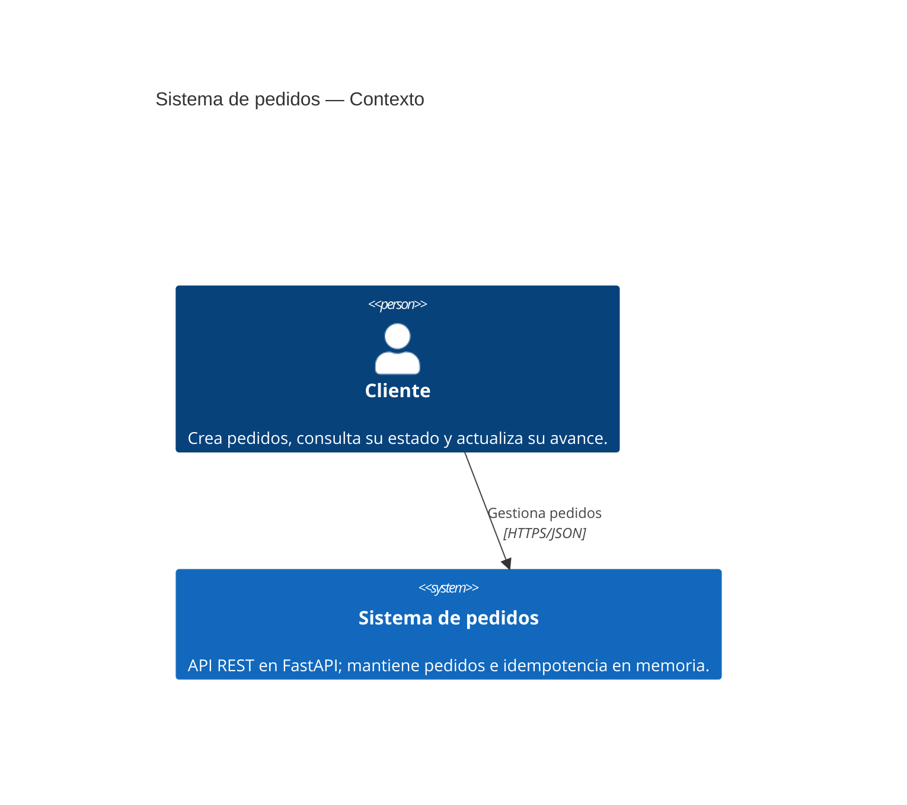

# Sistema de pedidos

API REST de pedidos construida con FastAPI. Esta entrega del Integrante 1
almacena pedidos en memoria e implementa protección contra duplicados mediante
el encabezado `X-Idempotency-Key`. La carpeta `src/proto/` se conserva para la
integración gRPC del resto del proyecto.

## Requisitos

- Python 3.10 o superior
- pip

## Instalación

Desde la carpeta raíz del proyecto, crea y activa un entorno virtual:

```powershell
py -m venv .venv
.\.venv\Scripts\Activate.ps1
```

Instala las dependencias fijadas:

```powershell
python -m pip install -r requirements.txt
```

## Ejecutar el servidor

```powershell
python -m uvicorn src.main:app --reload
```

La API queda disponible en <http://127.0.0.1:8000>. FastAPI publica la
documentación interactiva en <http://127.0.0.1:8000/docs> y el esquema OpenAPI
en <http://127.0.0.1:8000/openapi.json>.

## Endpoints

| Método | Ruta | Descripción |
|---|---|---|
| `POST` | `/orders/` | Crea un pedido y calcula `total` como `quantity * unit_price`. Requiere `X-Idempotency-Key`. |
| `GET` | `/orders/` | Lista todos los pedidos. |
| `GET` | `/orders/{order_id}` | Consulta un pedido por su ID de 8 caracteres. |
| `PATCH` | `/orders/{order_id}/status` | Actualiza el estado a `PENDING`, `PREPARING`, `READY` o `PAID`. |

Ejemplo de cuerpo para crear un pedido:

```json
{
  "product": "Café",
  "quantity": 2,
  "unit_price": 3.50
}
```

El pedido se crea inicialmente con estado `PENDING`. El precio unitario debe
ser mayor que cero y tener hasta dos posiciones decimales. Los estados
aceptados están restringidos por el modelo; se permite seleccionar cualquiera
de ellos en una actualización.

## Prueba de idempotencia

Envía el mismo `POST` más de una vez con la misma clave y el mismo cuerpo. La
API devolverá el mismo pedido y no creará un duplicado:

```powershell
curl.exe -i -X POST "http://127.0.0.1:8000/orders/" `
  -H "Content-Type: application/json" `
  -H "X-Idempotency-Key: pedido-cliente-123" `
  -d '{"product":"Cafe","quantity":2,"unit_price":"3.50"}'
```

Repite el comando exactamente para comprobar que la respuesta conserva el
mismo `id`. Si se reutiliza una clave con un cuerpo diferente, la API responde
`409 Conflict`. Si falta la clave, FastAPI rechaza la petición. Las claves y los
pedidos viven en memoria, por lo que se reinician al detener el proceso.

## Diagrama de Contexto C4 — Nivel 1


