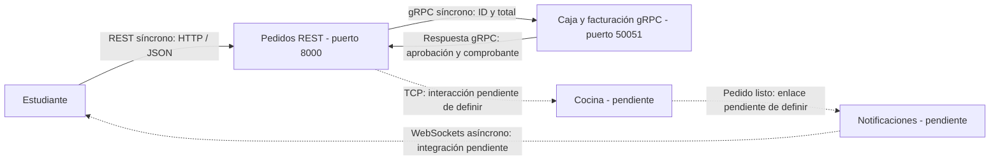

# Mapa de microservicios

| Servicio | Responsabilidad | Implementación |
| --- | --- | --- |
| Pedidos | Crear y consultar pedidos, evitar duplicados y actualizar estados | `src/main.py`, `src/services/orders.py` |
| Caja y facturación | Simular pagos, emitir comprobantes internos y resumir ventas | `src/billing_server.py`, `src/services/billing.py` |
| Cocina | Recibir pedidos y gestionar su preparación por TCP | Pendiente del integrante 3 |
| Notificaciones | Informar al estudiante por WebSockets | Pendiente del integrante 4 |

Pedidos y caja se ejecutan como procesos separados. Cada uno mantiene sus datos
en memoria; no comparten una base de datos. `src/services/billing_client.py`
es el cliente que pedidos utiliza para llamar a caja.

## Tipo de comunicación

| Comunicación | Mecanismo | Tipo y estado |
| --- | --- | --- |
| Estudiante a pedidos | REST | Síncrona: el cliente espera la respuesta HTTP. Implementada. |
| Pedidos a caja | gRPC unario | Síncrona: pedidos espera la respuesta de caja, con un plazo de dos segundos. Implementada. |
| Pedidos a cocina | Sockets TCP | Pendiente de integración. El integrante 3 debe definir si se espera una respuesta o se procesa sin bloquear al emisor. |
| Cocina a notificaciones | Por definir | Mecanismo y tipo pendientes de acordar entre integrantes 3 y 4. |
| Notificaciones al estudiante | WebSockets | Asíncrona en el diseño: el servidor enviará el aviso cuando el pedido esté listo. Pendiente de implementación. |

TCP y WebSockets permiten distintos patrones de intercambio; el carácter
síncrono o asíncrono depende de cómo se usen en el flujo. Las flechas punteadas
representan integraciones pendientes.

## Flujo implementado

1. El estudiante crea un pedido mediante `POST /orders/` con una clave de
   idempotencia.
2. Pedidos registra el pedido en `PENDING` y solicita el pago a caja por gRPC.
3. Caja registra la venta y devuelve un comprobante. Un reintento del mismo
   pedido y total devuelve el comprobante existente.
4. Pedidos cambia el estado a `PAID` y responde al estudiante.
5. Si caja no responde, pedidos devuelve `503` y conserva el pedido en
   `PENDING` para permitir reintentar el pago.

La entrega a cocina y las notificaciones todavía no están conectadas.
Después del pago, cocina podrá gestionar los estados `PREPARING` y `READY`.
