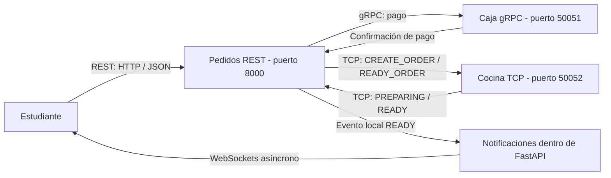

# Mapa de microservicios

| Servicio | Responsabilidad | Implementación |
| --- | --- | --- |
| Pedidos | Crear y consultar pedidos, evitar duplicados y actualizar estados | `src/main.py`, `src/services/orders.py` |
| Caja y facturación | Simular pagos, emitir comprobantes internos y resumir ventas | `src/billing_server.py`, `src/services/billing.py` |
| Cocina | Recibir pedidos pagados mediante Sockets TCP, gestionar su preparación, evitar duplicados y actualizar los estados `PREPARING` y `READY` | `src/kitchen_server.py`, `src/services/kitchen_client.py` |
| Notificaciones | Informar al estudiante mediante WebSockets cuando su pedido esté listo | `src/services/order_notifications.py` y `/ws/orders/{order_id}` en `src/main.py` |

Los servicios de pedidos, caja y cocina se ejecutan como procesos independientes y se comunican mediante mecanismos específicos.

Cada servicio mantiene sus datos en memoria, sin compartir una base de datos. El archivo `src/services/billing_client.py` permite que pedidos se comunique con caja mediante gRPC, mientras que `src/services/kitchen_client.py` permite enviar solicitudes a cocina mediante Sockets TCP.

El servidor de cocina escucha en `127.0.0.1:50052` y procesa solicitudes utilizando mensajes JSON delimitados por saltos de línea. Además, implementa controles de idempotencia para evitar que un mismo pedido se registre varias veces.

## Tipo de comunicación

| Comunicación | Mecanismo | Tipo y estado |
| --- | --- | --- |
| Estudiante a pedidos | REST | Síncrona: el cliente envía solicitudes HTTP y espera una respuesta. Implementada. |
| Pedidos a caja | gRPC unario | Síncrona: pedidos solicita el procesamiento del pago y espera la respuesta de caja, con un tiempo máximo de espera de dos segundos. Implementada. |
| Pedidos a cocina | Sockets TCP | Síncrona: pedidos envía mensajes JSON mediante TCP y espera una respuesta de cocina, con un timeout de dos segundos. Implementada por el integrante 3. |
| Cocina a pedidos | Sockets TCP | Síncrona: cocina responde a las solicitudes indicando estados como `PREPARING` y `READY`, o errores de procesamiento. Implementada. |
| Pedidos a notificaciones | Llamada local y asyncio.Event | Implementada dentro de FastAPI; activa el envío asíncrono cuando se guarda `READY`. |
| Notificaciones al estudiante | WebSockets | Asíncrona en el diseño: permitirá informar al estudiante cuando su pedido esté listo. `src/services/order_notifications.py` y `/ws/orders/{order_id}` en `src/main.py`. |

Los Sockets TCP permiten establecer una comunicación directa entre pedidos y cocina mediante conexiones de red. En esta implementación se utiliza un modelo síncrono de petición y respuesta.

El servidor TCP admite las operaciones `CREATE_ORDER`, `GET_ORDER` y `READY_ORDER`, que permiten registrar pedidos, consultar su estado y marcar su preparación como finalizada.

Para mejorar la confiabilidad, cocina identifica los pedidos por su ID. Si recibe nuevamente un pedido con el mismo identificador y contenido, evita duplicarlo. Si el identificador ya existe con información diferente, rechaza la solicitud.

Las flechas del diagrama representan comunicaciones implementadas. Notificaciones es un componente del proceso FastAPI, no un servidor independiente.

## Flujo implementado

1. El estudiante crea un pedido mediante `POST /orders/`, enviando los datos del producto y una clave de idempotencia mediante el encabezado `X-Idempotency-Key`.

2. El servicio de pedidos registra inicialmente la orden con estado `PENDING` y solicita el procesamiento del pago al servicio de caja mediante gRPC.

3. Caja procesa el pago, registra la venta y devuelve una confirmación. Si se repite una solicitud con el mismo ID y total, devuelve el comprobante existente sin duplicar el cobro.

4. Cuando el pago es aprobado, pedidos actualiza el estado a `PAID` y envía una solicitud `CREATE_ORDER` al servidor de cocina mediante Sockets TCP.

5. Cocina recibe la solicitud, valida la información del pedido y registra su preparación. Si la operación se realiza correctamente, responde con el estado `PREPARING`, que también se actualiza en el servicio REST.

6. Cuando el personal de cocina finaliza la preparación, se utiliza el endpoint `POST /orders/{order_id}/ready`. Este envía la operación `READY_ORDER` mediante TCP y actualiza el pedido al estado `READY`.

7. Si caja no responde durante el procesamiento del pago, el servicio REST devuelve un error `503` y conserva el pedido en `PENDING`, permitiendo reintentar el pago posteriormente.

8. Si cocina no está disponible después de confirmar el pago, REST devuelve un error `503`, pero conserva el pedido en `PAID`. Cuando cocina vuelve a estar disponible, puede utilizarse `POST /orders/{order_id}/dispatch` para reenviar el pedido sin realizar un segundo cobro.

9. Cuando un pedido alcanza el estado `READY`, FastAPI activa el evento local y envía `order_ready` a los estudiantes conectados por WebSockets. Al reconectar se recibe `order_status` con el estado actual.

## Estado actual de la implementación

El integrante 3 completó la implementación del servicio de cocina mediante Sockets TCP y su integración con los servicios REST y gRPC existentes.

Se incorporaron los siguientes componentes:

- `src/kitchen_server.py`: servidor TCP encargado de recibir solicitudes, administrar los pedidos y controlar sus estados.
- `src/services/kitchen_client.py`: cliente TCP utilizado por el servicio REST para comunicarse con cocina.
- `src/main.py`: integración del despacho de pedidos pagados y endpoints para reintentar envíos y marcar pedidos como listos.
- `tests/test_kitchen_tcp.py`: pruebas automatizadas de comunicación TCP, idempotencia, manejo de errores e integración con la API.

En la ejecución realizada, las nueve pruebas específicas de cocina finalizaron correctamente.

La integración con WebSockets está implementada en FastAPI. La ruta `/ws/orders/{order_id}` permite recibir el aviso y recuperar el estado actual al reconectar.

Como limitación actual, los datos se mantienen en memoria y pueden perderse al reiniciar los servicios. Además, el cambio manual de estado mediante `PATCH /orders/{order_id}/status` puede omitir la comunicación con cocina, por lo que se recomienda utilizar el endpoint específico `POST /orders/{order_id}/ready` para demostrar el flujo integrado.