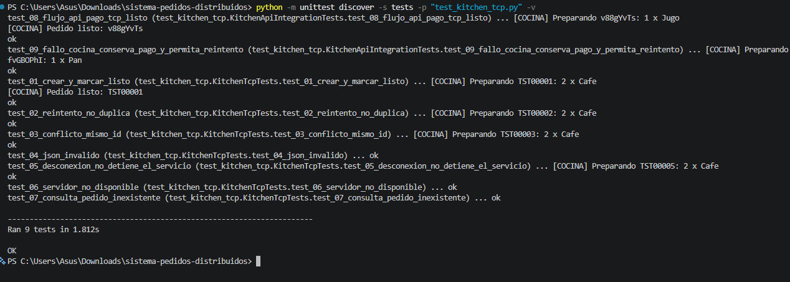

# Pruebas de comportamiento — Sockets TCP de cocina

**Responsable:** Esteban Hernandez.

**Asistencia IA:** Casos y redacción preliminar generados con ayuda de ChatGPT.

## Cómo ejecutar

Desde la raíz, después de instalar dependencias y generar código gRPC:

```powershell
python -m grpc_tools.protoc -I . --python_out=. --grpc_python_out=. src/proto/billing.proto
python -m unittest discover -s tests -p "test_kitchen_tcp.py" -v
```

El módulo ejecuta nueve pruebas: recepción y preparación, reintento idempotente,
conflicto de ID, JSON inválido, desconexión de cliente, servidor no disponible,
consulta inexistente, secuencia API → pago simulado → cocina → READY y fallo de
cocina conservando `PAID` con reintento.

## Escenario A — Reintento de mensaje TCP

- **Atributo:** confiabilidad/idempotencia.
- **Estímulo:** enviar dos veces `CREATE_ORDER` con el mismo ID, producto y cantidad.
- **Esperado:** primera respuesta `duplicate: false`; segunda `duplicate: true`;
  solo una entrada en cocina.
- **Evidencia real:**



*Figura 1. Ejecución de las pruebas de idempotencia del servicio TCP.*

## Escenario B — Cocina no responde

- **Atributo:** disponibilidad.
- **Estímulo:** detener el servicio TCP y crear un pedido con caja disponible.
- **Esperado:** `503`, pedido en `PAID`; al iniciar cocina y reintentar
  `POST /orders/{id}/dispatch`, cambia a `PREPARING` sin cobrar de nuevo.
- **Evidencia real:**

.png)

*Figura 2. Respuesta HTTP 503 cuando el servicio de cocina no está disponible.*

.png)

*Figura 3. Reintento del despacho y actualización del pedido a PREPARING.*

## Escenario C — Cliente se desconecta

- **Atributo:** robustez/tolerancia a fallos.
- **Estímulo:** cortar la conexión mientras se envía un JSON incompleto.
- **Esperado:** el servidor continúa activo y acepta el pedido siguiente.
- **Evidencia real:**

.png)

*Figura 4. Simulación de desconexión durante el envío de un mensaje JSON incompleto.*

.png)

*Figura 5. Respuesta del servidor TCP a una nueva conexión después de la desconexión.*

## Resultado de verificación automatizada

El 16 de noviembre de 2026 se ejecutó el conjunto completo del repositorio con
`python -m unittest discover -s tests -v`: las 15 pruebas pasaron, incluidas las
nueve de cocina. Se corrigió la prueba de finalización para esperar la función
asíncrona `mark_order_ready`. Las pruebas de integración de cocina simulan la
respuesta de caja; este resultado no sustituye una demostración en vivo de los
cuatro mecanismos. Los escenarios relacionados son el 3 y el 4 de
[escenarios de calidad](escenarios-calidad.md).


## Interpretación de resultados

TCP entrega un flujo de bytes y no preserva por sí mismo los límites de mensaje:
por eso se usa `\n` y límite de 4096 bytes. Un timeout evita la espera infinita.
La deduplicación se realiza por ID en la lógica de cocina, no es una función
nativa de TCP. Estas medidas reducen fallos, pero los datos en memoria
se pierden si el servicio reinicia.
